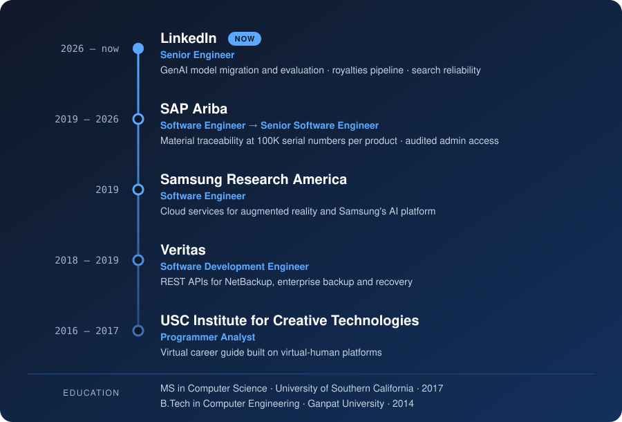

<p align="center">
  
</p>

<p align="center">
  
  
  
  <a href="https://www.linkedin.com/in/dip-pansuriya"></a>
</p>

## 01 · Baseline <sub>who I am</sub>

Swapping the model behind a live AI product is easy to do and hard to do safely. At LinkedIn I led the program that moved production LLM workloads, including LinkedIn Learning's AI Coach, from a third-party cloud model to in-house open-weight models. I also built the evaluation framework that decided when each workload was ready to cut over.

My rule is simple: **no switch without evidence.** Every cutover first had to pass LLM-as-a-judge scoring with calibration above 95%, golden datasets, and a live A/B experiment. The outcome was **97–98% quality parity and 100% safety parity** with the model we replaced.

Before LinkedIn I spent six and a half years at SAP Ariba, and earlier worked at Samsung Research America and Veritas. I hold an MS in Computer Science from the University of Southern California.

**Currently exploring:** LLM-as-a-judge calibration · serving open-weight models · evaluation for agentic systems

## 02 · Evidence <sub>the work, with the checks it passed</sub>

### 1 · AI Coach: moving a production LLM to open-weight models

`LinkedIn` · `2026`

```text
cutover   third-party cloud LLM  ──▶  in-house open-weight model (Qwen)
serving   vLLM · SGLang on GPU inference

check                          result
─────────────────────────────────────────────
LLM-as-a-judge calibration     target > 95%
golden-dataset quality         97–98% parity
safety                         100% parity
online A/B experiment          run before every cutover

verdict   SHIP
```

Moved LinkedIn Learning's AI Coach and other live workloads off a third-party LLM without a drop in quality or safety.

<details>
<summary><b>How the cutover was run</b></summary>
<br>

**The problem.** LinkedIn Learning's AI Coach and other production workloads ran on a third-party cloud LLM. Moving them in-house meant changing the model under a live product without users noticing a drop in quality or safety.

**What I did.**
- Led the migration program across the portfolio of GenAI workloads, not just one product.
- Designed the evaluation framework every cutover had to pass: an LLM judge calibrated before it was trusted, golden datasets for offline scoring, then an online A/B experiment.
- Set the bar as parity with the model being replaced, so each decision to ship rested on measurements.

**What changed.** Workloads now run on in-house open-weight models, with less dependency on an external API and stronger data privacy and compliance.

</details>

## 03 · Rollout <sub>where I have shipped</sub>

<p align="center">
  
</p>

## 04 · Stack <sub>what I build with</sub>

```text
GenAI     LLM evaluation · LLM-as-a-judge · open-weight models · vLLM · SGLang
Data      Kafka · Spark/Scala · Airflow · Trino
Backend   Java · Python · Spring · REST APIs · microservices
Cloud     AWS · GCP · Azure · Kubernetes · Docker · CI/CD
```

## 05 · Handoff <sub>get in touch</sub>

<a href="https://www.linkedin.com/in/dip-pansuriya"></a>
